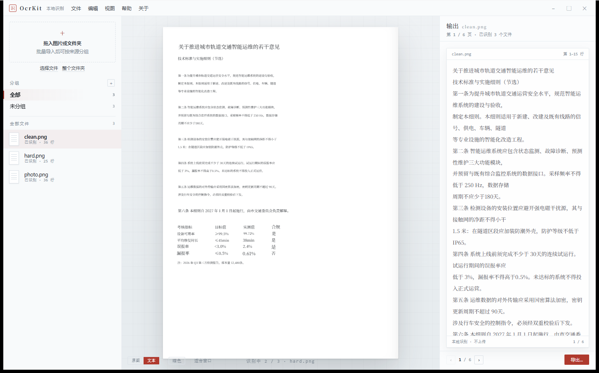
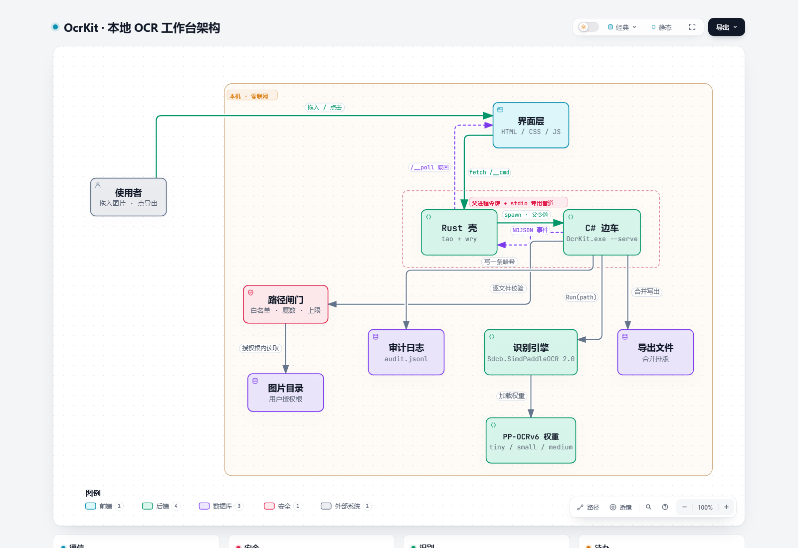

# small-trash

一个本地 OCR 工作台，和一套自己用的 agent skills。

没有云、没有账号、没有上传。图片从拖进来那一刻起就没离开过这台机器。



## 这个仓库里有什么

| 目录 | 内容 |
|---|---|
| `src/ocrkit/` | C# 识别引擎与边车（.NET 10，PP-OCRv6） |
| `src/shell/` | Rust 外壳（tao + wry / WebView2）与 HTML 界面 |
| `tools/` | PDF 预处理脚本 |
| `docs/` | 架构图（可交互 HTML）与截图 |
| `skills/method-harvest/` | 把踩过的坑沉淀成 skill 的方法 |
| `skills/trash/` | 其余自研 skill，用得上就拿走 |

## OcrKit

### 它做什么

拖进图片或文件夹 → 本地识别 → 右侧分页出文本 → 合并导出。

- **引擎**：PP-OCRv6（medium 单张约 0.3 秒），Vulkan 优先，跑不动自动退 CPU
- **界面**：无边框窗口，三栏布局，瓷白与暗色两套主题
- **文本层**：按识别的八点框把文字排回纸面原位，不是另起一页
- **表格**：按同一 y 归行、按 x 聚列还原成真表格，不引入额外模型
- **导出**：按文件名自然排序合并，可选目录、分节标题、分页；txt / md / json

### 它怎么保证不上传

- 壳与边车只走 stdin/stdout，**不开任何监听端口**
- 边车只认 64 位父进程令牌启动，父进程退出它自己退出
- 所有文件读取先过路径闸门：只认用户显式授权的根，拒绝 UNC 与设备路径
- 按文件头认格式，扩展名对不上直接拒；96 MB / 1.2 亿像素封顶
- 审计日志只记路径哈希与耗时，正文一个字都不落盘

## 架构

[](docs/ocrkit-architecture.html)

点图看可交互版本（节点可展开说明）。

## 构建

需要 .NET 10 SDK、Rust 工具链、WebView2 运行时（Win10/11 自带）。

```powershell
# 边车
dotnet build src/ocrkit/OcrKit.csproj -c Release

# 外壳
cd src/shell/rust
cargo build --release
```

外壳里的 `ENGINE_EXE` 与 `UI_DIR` 是绝对路径常量，第一次跑之前改成你本机的路径。

## 许可与致谢

代码以 MIT 发布。识别能力来自别人的作品，**完整署名在 [THIRD-PARTY-NOTICES.md](THIRD-PARTY-NOTICES.md)**：

- [Sdcb.SimdPaddleOCR](https://github.com/sdcb/SimdPaddleOCR) 2.0（Apache-2.0）—— 推理引擎本体，未改动一行
- [PP-OCRv6](https://github.com/PaddlePaddle/PaddleOCR) 权重（Apache-2.0）—— 百度 PaddleOCR
- [Sdcb.SimdCodecs](https://github.com/sdcb/SimdCodecs)（MIT）—— 图像解码
- .NET 10 运行时（MIT）
- [wry](https://github.com/tauri-apps/wry) / [tao](https://github.com/tauri-apps/tao)（Apache-2.0 / MIT）—— 窗口与 WebView

## 已知未完成

- 跨页表格与合并单元格仍会拆散
- 导出范围「当前分组」刚接上，未回归
- MinerU 精修表格只留了位置，没接
